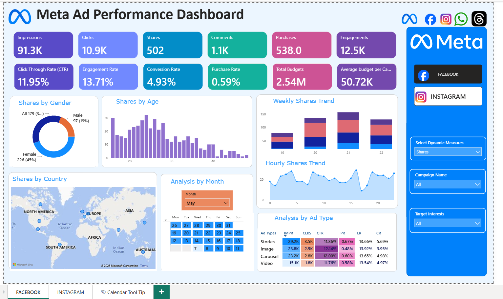
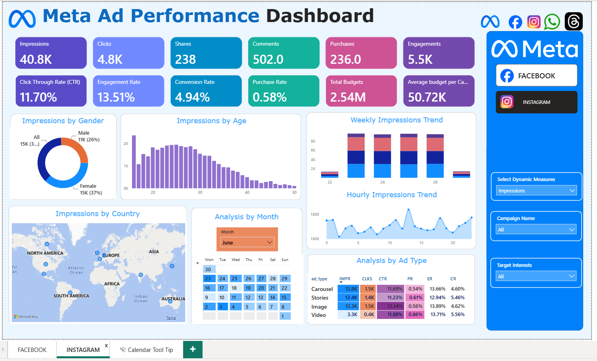
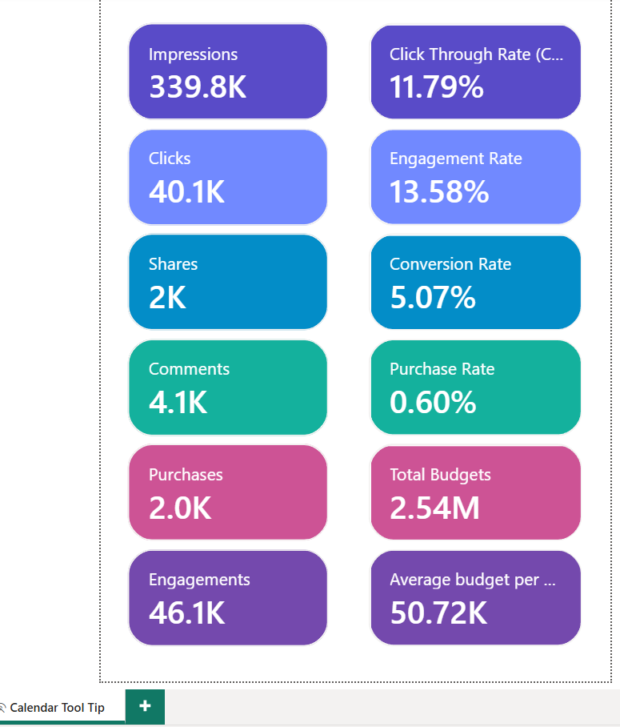
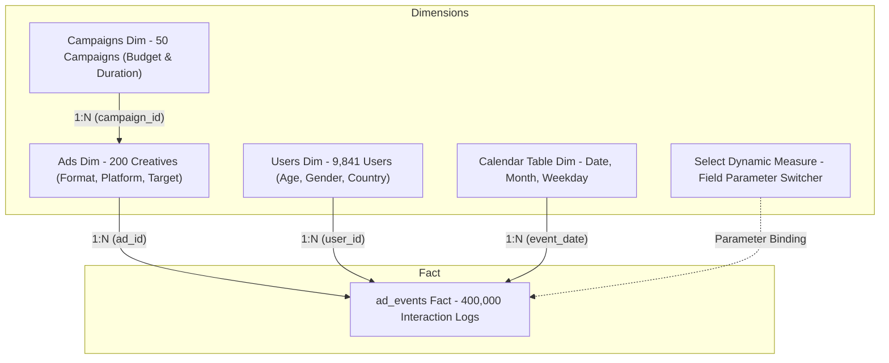

# 📊 Meta Ad Campaign Performance & Marketing Intelligence (Power BI + SQL)

[](https://powerbi.microsoft.com/)
[](https://dax.guide/)
[](https://www.postgresql.org/)
[](https://www.mysql.com/)
[](https://github.com/ravinder0710)

> **Enterprise Digital Marketing Analytics Platform**: An end-to-end multi-table BI solution modeling **400,000+ real-time ad interaction event logs** across Meta's flagship advertising platforms (**Facebook & Instagram**). Evaluates full-funnel customer acquisition, creative format efficiency, viral engagement, and ROI across a **$2.54 Million ad spend**.

---

## 📌 Executive Summary & Business Context

Digital advertising across Meta platforms requires balancing **creative content velocity** with **strict budget allocation**. Marketing decision-makers need real-time clarity on which ad creatives, demographic cohorts, and placement formats generate profitable customer conversions versus those causing ad fatigue.

This project delivers an interactive, dual-platform business intelligence suite:

1. **Full-Funnel Acquisition Modeling:** Tracks the journey from **Ad Impression (339.8K)** ➔ **Click Intent (40.1K)** ➔ **Viral Engagement (46.1K)** ➔ **Purchase Conversion (2.0K)** across 50 active advertising campaigns.
2. **Cross-Platform Attribution:** Side-by-side performance benchmarking isolating **Facebook vs. Instagram** ad effectiveness across identical target audiences.
3. **Dynamic Measure Parameterization:** Implemented Power BI Field Parameters allowing stakeholders to switch the entire report canvas on-the-fly between **Impressions, Clicks, Shares, Comments, and Purchases**.
4. **SQL Data Verification Layer:** Backed by a production SQL suite validating aggregations, event parsing, windowed trends, and demographic cohorts across database engines.

---

## 🖥️ Interactive Dashboard Showcase

### 1. Facebook Campaign Performance View


### 2. Instagram Campaign Performance View


### 3. Custom Hover Tooltip Canvas (Daily Calendar Micro-Drilldown)
<p align="center">
  
</p>

> *Hovering over any day in the monthly calendar matrix instantly surfaces full 10-KPI funnel performance for that specific calendar date without cluttering the executive layout.*

---

## 🎯 Key Performance Indicators & Global Benchmarks

| Marketing KPI | Formula / Definition | Portfolio Actual | Industry Standard / Benchmark |
| :--- | :--- | :---: | :---: |
| **Total Event Volume** | Fact record log population | **400,000 rows** | Enterprise Scale |
| **Gross Impressions** | Total times ads were displayed on feeds/stories | **339.8K** | Top-of-Funnel Reach |
| **Total Clicks** | Direct click-through interactions | **40.1K** | High User Intent |
| **Click-Through Rate (CTR)** | `Clicks / Impressions` | **11.79%** 🟢 | Typical Meta Benchmark: 0.90% – 2.50% |
| **Viral Shares** | User forwards to friends/family | **2.0K (1,957)** | Viral Reach Amplifier |
| **User Comments** | Direct post replies & feedback | **4.1K (4,108)** | Sentiment & Brand Engagement |
| **Total Engagements** | `Clicks + Shares + Comments` | **46.1K (46,144)** | Aggregate Brand Engagement |
| **Engagement Rate (ER)** | `Engagements / Impressions` | **13.58%** 🟢 | Strong Audience Resonance |
| **Customer Purchases** | Completed conversions post-click | **2.0K (2,031)** | Bottom-of-Funnel Conversion |
| **Conversion Rate (CR)** | `Purchases / Clicks` | **5.07%** 🟢 | E-Commerce Standard: 2.0% – 3.5% |
| **Purchase Rate (PR)** | `Purchases / Impressions` | **0.60%** | Conversion Reach Efficiency |
| **Total Campaign Budget** | Total capital allocated across 50 campaigns | **$2.54 Million** | Multi-Month Media Spend |
| **Avg Budget per Campaign** | `Total Budget / Campaign Count` | **$50.72K** | Portfolio Allocation |

---

## 🏗️ Data Architecture & Snowflake Modeling

The data model unifies 4 raw CSV sources, a calculated calendar dimension, and dynamic field parameters into an optimized snowflake schema:



### Table Specifications:
1. **`ad_events` (Fact Table - 400,000 rows)**: Granular log storing `event_id`, `ad_id`, `user_id`, `timestamp`, `day_of_week`, `time_of_day`, and `event_type`.
2. **`ads` (Dimension - 200 rows)**: Creative specifications (`ad_platform`: Facebook/Instagram, `ad_type`: Video/Stories/Image/Carousel, targeting filters).
3. **`campaigns` (Dimension - 50 rows)**: Flight dates, total campaign budget, and run duration.
4. **`users` (Dimension - 9,841 rows)**: Demographic profiles, gender, age cohorts, home country, and interest affinities.
5. **`calendar_table` (DAX Generated)**: Continuous date spine from May 7 to August 6, 2025, with ISO week mapping and sort-by-column attributes.

---

## 💡 Strategic Marketing Insights & Deep Dives

### 1. Facebook vs. Instagram Platform Benchmark
* **Facebook**: Dominates total reach (**91.3K impressions, 10.9K clicks, 538 purchases**) with an outstanding **11.95% CTR** and **13.71% Engagement Rate**.
* **Instagram**: Excels in high-velocity mobile formats (Stories & Reels) with **40.8K impressions, 4.8K clicks, 236 purchases**, maintaining an **11.70% CTR** and a **13.51% Engagement Rate**.
* **Attribution Verdict**: While Instagram delivers higher aesthetic engagement per visual unit, Facebook provides larger overall volume and scale for direct purchase conversion.

### 2. Creative Format (Ad Type) Performance
| Creative Format | Impressions | Clicks | CTR % | Purchase Rate % | Engagement Rate % | Conversion Rate % | Strategic Guidance |
| :--- | :---: | :---: | :---: | :---: | :---: | :---: | :--- |
| **Stories** | **29.2K** | **3.5K** | 11.86% | **0.67%** 🟢 | 13.66% | **5.69%** 🟢 | *Highest purchase efficiency; scale budget here.* |
| **Carousel** | **23.2K** | **2.8K** | **12.00%** 🟢 | 0.60% | **13.65%** | 4.98% | *Highest CTR; ideal for multi-product showcases.* |
| **Image** | **23.8K** | **2.9K** | 12.14% | 0.56% | 13.92% | 3.95% | *Strong initial engagement; moderate drop-off at checkout.* |
| **Video** | **15.1K** | **1.8K** | 11.76% | 0.58% | 13.54% | 4.97% | *High retention hook; effective for top-of-funnel storytelling.* |

### 3. Audience Demographic Targeting
* **Gender Skew**: Female users represent **45% of total engagement**, while combined unisex campaigns drive **36%**, and exclusively male-targeted campaigns account for **19%**.
* **Age Distribution**: Highly concentrated in the **Gen-Z and Young Millennial cohort (Ages 16–26)**, peaking at age 16 and steadily declining past age 35. Creative assets must prioritize mobile-first, short-form styling.
* **Hourly Activity Peaks**: Distinct surges occur during morning commuting hours (7:00 AM – 9:00 AM) and evening leisure hours (7:00 PM – 10:00 PM). Ad pacing algorithms should be weighted toward these daypart windows.

---

## 📐 Advanced DAX Measure Architecture

All core business calculations are centralized in the analytical layer:

```dax
// 1. Core Event Funnel Measures
Impressions = 
CALCULATE(
    COUNTROWS(ad_events),
    ad_events[event_type] = "Impression"
)

Clicks = 
CALCULATE(
    COUNTROWS(ad_events),
    ad_events[event_type] = "Click"
)

Shares = 
CALCULATE(
    COUNTROWS(ad_events),
    ad_events[event_type] = "Share"
)

Comments = 
CALCULATE(
    COUNTROWS(ad_events),
    ad_events[event_type] = "Comment"
)

Purchases = 
CALCULATE(
    COUNTROWS(ad_events),
    ad_events[event_type] = "Purchase"
)

// 2. Aggregate Engagement
Engagements = [Clicks] + [Shares] + [Comments]

// 3. Efficiency & Ratio Metrics
Click Through Rate (CTR) = 
DIVIDE([Clicks], [Impressions], 0)

Engagement Rate = 
DIVIDE([Engagements], [Impressions], 0)

Conversion Rate = 
DIVIDE([Purchases], [Clicks], 0)

Purchase Rate = 
DIVIDE([Purchases], [Impressions], 0)

// 4. Budget Allocation
Total Budgets = SUM(campaigns[total_budget])

Average budget per Campaign = AVERAGE(campaigns[total_budget])

// 5. Dynamic Measure Header Callout
Gender Title = 
SELECTEDVALUE('Select Dynamic Measure'[Dynamic Title], "Metrics") & " by Gender"
```

---

## 💻 SQL Verification & Validation Suite

To ensure data integrity between the BI visualization layer and the underlying warehouse, the SQL script [`sql/Meta_Ad_Performance_Analysis.sql`](sql/Meta_Ad_Performance_Analysis.sql) executes end-to-end reconciliation:

### Funnel Validation Query Sample:
```sql
SELECT
    COUNT(CASE WHEN event_type = 'Impression' THEN 1 END) AS total_impressions,
    COUNT(CASE WHEN event_type = 'Click' THEN 1 END) AS total_clicks,
    COUNT(CASE WHEN event_type = 'Purchase' THEN 1 END) AS total_purchases,
    COUNT(CASE WHEN event_type IN ('Click', 'Share', 'Comment') THEN 1 END) AS total_engagements,
    ROUND(COUNT(CASE WHEN event_type = 'Click' THEN 1 END)::NUMERIC /
          NULLIF(COUNT(CASE WHEN event_type = 'Impression' THEN 1 END), 0) * 100, 2) AS ctr_pct,
    ROUND(COUNT(CASE WHEN event_type = 'Purchase' THEN 1 END)::NUMERIC /
          NULLIF(COUNT(CASE WHEN event_type = 'Click' THEN 1 END), 0) * 100, 2) AS conversion_rate_pct
FROM ad_events;
```

---

## 🗂️ Repository Structure

```
meta-ad-campaign-performance-powerbi/
├── assets/
│   ├── meta_ad_facebook_dashboard.png     # Full Executive Facebook Analytics View
│   ├── meta_ad_instagram_dashboard.png    # Full Executive Instagram Analytics View
│   └── meta_ad_calendar_tooltip.png       # Micro-Drilldown Daily Calendar Tooltip Canvas
├── data/
│   ├── ad_events.csv                      # 400,000 Row Event-Level Fact Table
│   ├── ads.csv                            # 200 Creative Configurations & Types
│   ├── campaigns.csv                      # 50 Marketing Campaigns & Budgets
│   └── users.csv                          # 9,841 Registered Users & Demographics
├── sql/
│   └── Meta_Ad_Performance_Analysis.sql   # Production SQL Validation & Analysis Script
├── .gitignore                             # Clean git exclusion rules
├── Facebook & Instagram Analysis.pbix     # Master Power BI Dashboard File
├── README.md                              # Comprehensive Project Documentation
└── requirements.txt                       # Environment & Dependency Manifest
```

---

## 🚀 How to Run & Replicate

### 1. Power BI Desktop Exploration
1. Clone this repository:
   ```bash
   git clone https://github.com/ravinder0710/meta-ad-campaign-performance-powerbi.git
   cd meta-ad-campaign-performance-powerbi
   ```
2. Open [`Facebook & Instagram Analysis.pbix`](Facebook%20&%20Instagram%20Analysis.pbix) in **Power BI Desktop**.
3. Toggle between the **FACEBOOK** and **INSTAGRAM** tabs via navigation buttons.
4. Use the **Select Dynamic Measures** dropdown on the right rail to switch all visuals between *Impressions*, *Clicks*, *Shares*, *Comments*, and *Purchases*.
5. Hover over any day in the **Analysis by Month** calendar to trigger the micro-tooltip!

### 2. SQL Warehouse Execution
1. Create a database in PostgreSQL or MySQL.
2. Execute the DDL statements in [`sql/Meta_Ad_Performance_Analysis.sql`](sql/Meta_Ad_Performance_Analysis.sql).
3. Import the CSV files in order: `campaigns.csv` ➔ `ads.csv` ➔ `users.csv` ➔ `ad_events.csv`.
4. Run analytical queries Q1 through Q10 to reproduce all KPI outputs.

---

## 👨‍💻 Author & Contact

**Ravinder Gupta**  
*Data Analyst | SQL · Power BI · DAX · Python · Advanced Excel*

* 📧 **Email**: [iamravindergupta17@gmail.com](mailto:iamravindergupta17@gmail.com)
* 💬 **WhatsApp**: [+91 9982637026](https://wa.me/919982637026?text=Hi%20Ravinder,%20saw%20your%20Meta%20Ad%20Performance%20Dashboard)
* 💼 **GitHub**: [github.com/ravinder0710](https://github.com/ravinder0710)
* 📍 **Location**: Alwar, Rajasthan, India

---
*Developed with a commitment to data integrity, scalable modeling, and actionable business intelligence.*
